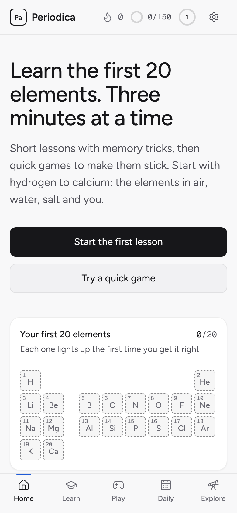
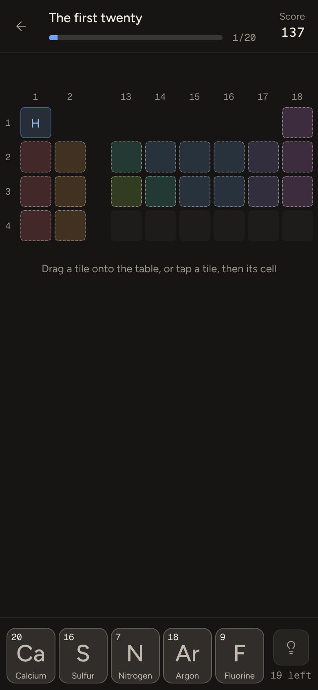
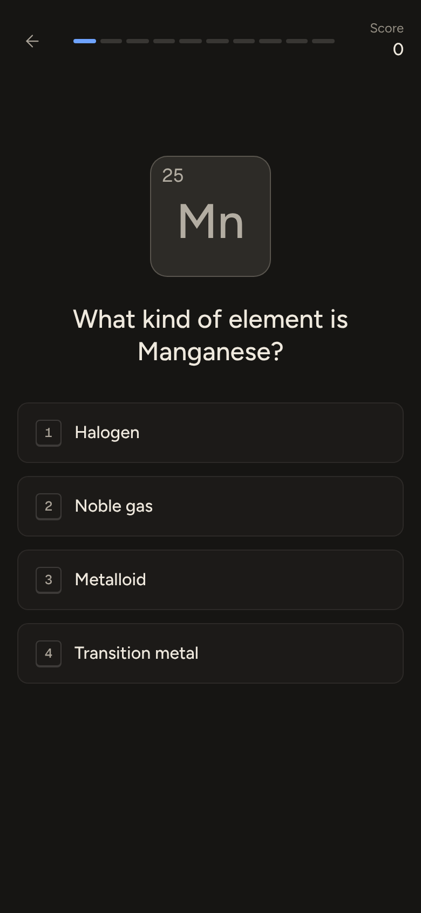
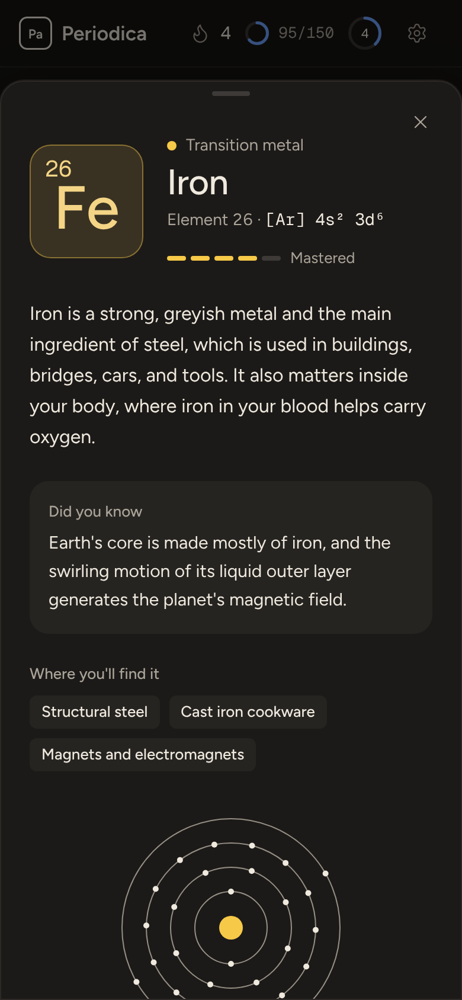
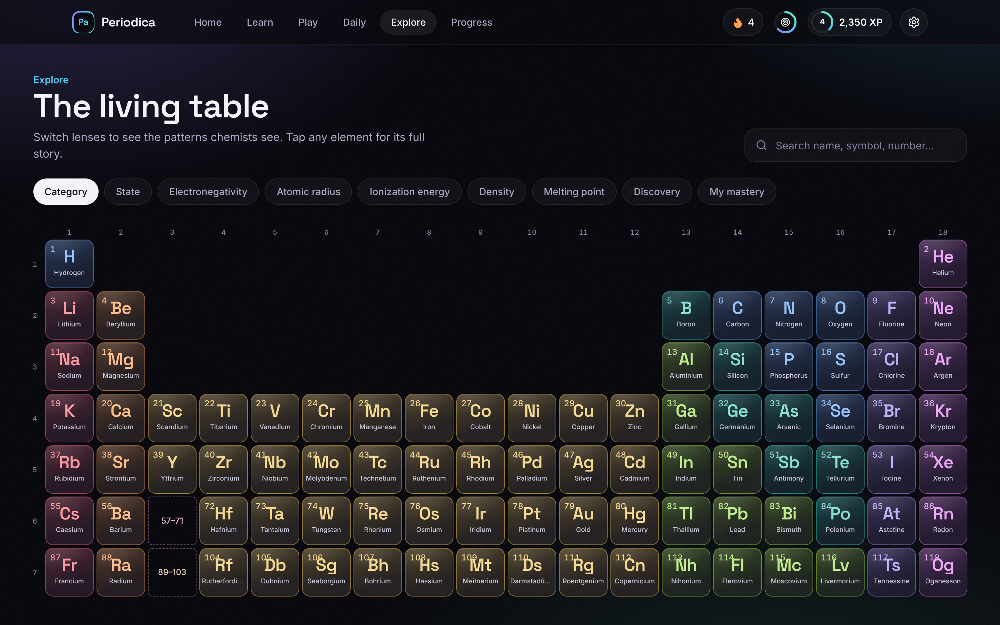

# Periodica

Learn the periodic table by playing with it. Short lessons, drag-and-drop puzzles, a daily challenge, quizzes, and "In Real Life" rounds that connect elements to everyday things.

**Live app:** https://aarushagrawal267-maker.github.io/Periodic-table/

Periodica is a free, installable web app (PWA) for school students who need to learn the 118 elements. Instead of memorising a chart, students place elements on an empty table, match symbols to names and spot the elements inside a phone or a banana. It works offline, needs no sign-up, and keeps progress on the device. Accounts are optional and sync progress across devices when they are switched on.

<p>
  
  
  
  
</p>



More screenshots are in [`screenshots/`](screenshots/).

## Features

| Section | What the student does |
|---|---|
| **Learn** | A path of 13 short chapters (from "The lightest ten" to "Made in the lab") with flashcards, memory tricks and a placement round at the end of each chapter. |
| **Play (puzzles)** | Drag elements from a tray onto an empty table, region by region (the first twenty, reactive metals, the right-hand side, transition metals, lanthanides and actinides, the full table), on three difficulty levels. Combos, speed bonus, stars and hints. Works with touch, mouse and keyboard. |
| **Daily challenge** | Twelve elements to place, the same for everyone each day (seeded by date), one attempt, a streak and a shareable result. |
| **Quick quiz** | Ten questions on symbols, names, atomic numbers, element groups and facts, with an optional timer. |
| **Match pairs** | A memory game pairing element symbols with their names. |
| **In real life** | Guess which elements are inside everyday objects such as a phone, fireworks or a banana. |
| **Explore** | The full table of 118 elements with search; each element has a summary, uses, a fact and its properties (from PubChem). |
| **Review** | Spaced review of elements the student got wrong, so weak elements come back. |
| **Progress** | XP and levels, a daily XP goal, achievements, elements started and mastered, and a summary a student can show a teacher. |
| **Settings** | Sound, haptics, reduced motion, colour-blind friendly palette, difficulty and quiz timer. |
| **Accounts (optional)** | Google or email sign-in; guest progress merges into the account and syncs across devices through Cloud Firestore, with offline support. Off unless Firebase is configured. |
| **Installable and offline** | A PWA with a service worker: add it to the home screen and it runs without a connection. |

## How it works

- **Data.** `scripts/build-data.mjs` joins the PubChem periodic-table export (`scripts/source/pubchem-periodic-table.json`) with hand-written learning content (`src/data/content-1.json`, `src/data/content-2.json`) into `src/data/elements.json`. Unit tests check all 118 elements are present and consistent.
- **Layout.** `src/lib/layout.ts` maps every element to its row and column, with the f-block shown as two detached rows. `src/lib/regions.ts` defines the puzzle regions.
- **Game rules.** `src/lib/game.ts` and `src/lib/scoring.ts` are pure functions: a placement is accepted only in the right cell, points grow with combos and speed, and stars come from accuracy. The daily challenge uses a seeded random generator (`src/lib/random.ts`, `src/lib/daily.ts`) so everyone gets the same twelve elements.
- **State.** Two small zustand stores (`src/store/progress.ts`, `src/store/settings.ts`) are persisted to `localStorage`. Mastery per element drives the review queue (`src/lib/review.ts`).
- **Sync (optional).** `src/lib/sync.ts` and `src/lib/merge.ts` merge local and cloud progress with a conflict-free join (per-device counters, max/union for everything else), written in Firestore transactions. The full design is in [`docs/ACCOUNTS.md`](docs/ACCOUNTS.md); the Firestore security rules are in `firestore.rules`.
- **Routing.** Hash routing (`#/play`, `#/learn`, ...) so the static build works on GitHub Pages with no server.

## Run it

Needs [Node.js](https://nodejs.org/) 22 or newer.

```bash
git clone https://github.com/aarushagrawal267-maker/periodic-table.git
cd periodic-table
npm install
npm run dev
```

Open the address Vite prints (usually http://localhost:5173/).

To build the static site and preview it:

```bash
npm run build
npm run preview
```

`dist/` is plain static files and can be hosted anywhere (GitHub Pages, Netlify, any web server).

### Optional: accounts

Without any configuration the app is guest-only and makes no network calls. To turn accounts on, create a Firebase project, copy `.env.example` to `.env.local` and fill in the values, as described in [`docs/ACCOUNTS.md`](docs/ACCOUNTS.md) (section 10). To try accounts locally with no real Firebase project, run `npm run emulators` in one terminal and `npm run dev:accounts` in another.

## Scripts

| Command | What it does |
|---|---|
| `npm run dev` | Start the dev server |
| `npm run build` | Type-check and build to `dist/` (static, deploy anywhere) |
| `npm run preview` | Serve the built `dist/` locally |
| `npm test` | Run the unit tests (data integrity, game rules, scoring, daily seed, review, merge and sync logic) |
| `npm run test:e2e` | Build and run the browser tests with Playwright (desktop and phone layouts) |
| `npm run test:rules` | Test the Firestore security rules on the Firebase emulator (needs Java) |
| `npm run test:accounts` | Sync tests and account browser tests on the Firebase emulators (needs Java) |
| `npm run data` | Rebuild `src/data/elements.json` from the PubChem export and the learning content |
| `node scripts/og-image.mjs` | Re-render the link-preview image `public/og.png` from `scripts/og-image.html` |
| `node --test social/publish/` | Tests for the social media posting scripts |

## Tests

- `tests/`: Vitest unit tests (data integrity, game, scoring, quiz modes, review, progress, merge, sync, account guards).
- `e2e/`: Playwright browser tests for the main flows (navigation, lessons, puzzles, daily challenge, match, explore, review, accounts-off build).
- `tests-emulator/` and `e2e-accounts/`: Firestore rules, sync and account flows against the Firebase emulators.
- `social/publish/test/`: Node test runner tests for the posting scripts.

CI (`.github/workflows/ci.yml`) runs the unit tests and the build on every push. `.github/workflows/deploy.yml` tests, builds and publishes `dist/` to the `gh-pages` branch on every push to `main`.

## Tech stack

- React 19 and TypeScript, built with Vite
- Tailwind CSS 4 for styling, Motion for animation, lucide-react icons
- zustand for state, persisted to `localStorage`
- vite-plugin-pwa (Workbox) for offline support and install
- Firebase Authentication and Cloud Firestore for optional accounts (loaded only when configured)
- Vitest, Playwright and the Firebase emulators for testing
- GitHub Actions and GitHub Pages for CI and hosting

## Project structure

```
src/
  App.tsx, main.tsx     app shell and hash router
  screens/              one file per screen (Home, Learn, Play, Game, Daily, Quiz, Match, Life, Explore, Progress, Account)
  components/           shared UI (periodic grid, element tile and detail, results, settings sheet, toasts)
  lib/                  pure logic (layout, regions, game, scoring, quiz, daily seed, review, achievements, merge, sync)
  store/                zustand stores for progress, settings and UI
  data/                 elements.json (generated) and the learning content
  styles/               Tailwind entry and design tokens
scripts/                data build and link-preview image scripts, PubChem source data
public/                 icons, og image, robots.txt, sitemap.xml, llms.txt
tests/, e2e/            unit and browser tests
tests-emulator/, e2e-accounts/   Firebase emulator tests
docs/                   ACCOUNTS.md (account system design), DESIGN.md (design rules), SOCIAL_SETUP.md
social/                 short-video renderer (reels/) and Instagram/YouTube posting scripts (publish/)
firestore.rules, firebase.json   Firebase security rules and emulator config
```

## Data and privacy

- Element properties: PubChem (NCBI), `scripts/source/pubchem-periodic-table.json`.
- Learning content (summary, uses, fact for each element): `src/data/content-1.json`, `src/data/content-2.json`.
- Progress is stored in the browser's local storage. Accounts are optional: a student who signs in with Google or an email has their progress saved to their account in Cloud Firestore (Google Firebase) and synced across devices. A build without the `VITE_FIREBASE_*` variables has no accounts and sends nothing to a server. See `docs/ACCOUNTS.md`.

## Limitations

- The live site is built without Firebase settings, so accounts are switched off there until a Firebase project is connected (see `docs/ACCOUNTS.md`). Guest mode is fully functional.
- English only.
- The main JavaScript bundle is about 670 kB (about 205 kB gzipped); it is cached by the service worker after the first visit.
- Element data covers the properties PubChem publishes; for the heaviest synthetic elements many properties are unknown and are shown as such.
- Social posting (`social/`) needs the owner's Instagram and YouTube credentials; see `docs/SOCIAL_SETUP.md`.

## License

The code is released under the MIT License, see [`LICENSE`](LICENSE). PubChem data is from the U.S. National Library of Medicine. The `unslop` design skill in `.claude/skills/unslop/` is by Damir Sokolovsky and licensed CC BY 4.0 (see its own `LICENSE`).
